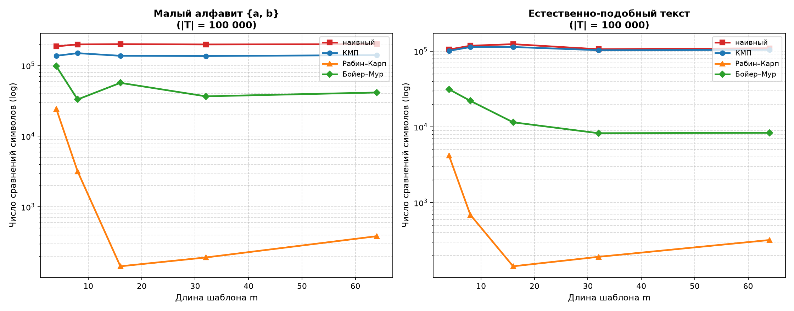
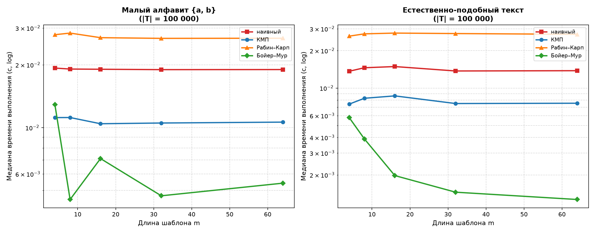

# Отчёт по лабораторной работе № 7
## «Сравнительный анализ КМП, Рабина–Карпа и Бойера–Мура»

**Дисциплина:** Структуры и алгоритмы обработки данных  
**Модуль 4:** Поиск и хеширование  
**КИМ:** [КИМ-07](../M4-search-and-hashing/kim-07-substring-search.md)  
**Рубрика:** [Рубрика-07](../M4-search-and-hashing/rubric-07-substring-search.md)  
**Вариант:** 21 (`seed = 30 + 21 = 51`)  

---

### 1. Цель работы и формируемые результаты

Освоить классические алгоритмы точного поиска подстроки в тексте (наивный поиск, Кнут–Моррис–Пратт, Рабин–Карп, Бойер–Мур) и экспериментально исследовать их сравнительную эффективность:
1. Реализовать наивный алгоритм поиска подстроки со сдвигом на одну позицию в качестве эталонной базовой модели.
2. Реализовать алгоритм Кнута–Морриса–Пратта (КМП) с выделением построения префикс-функции шаблона $\pi$ в отдельную функцию и сохранением возможности нахождения всех перекрывающихся вхождений.
3. Реализовать алгоритм Рабина–Карпа с полиномиальным кольцевым хешем, пересчётом скользящего хеша за $O(1)$ и **обязательной посимвольной проверкой** окна при совпадении хешей для исключения ложных срабатываний из-за коллизий.
4. Реализовать алгоритм Бойера–Мура с поддержкой **обеих эвристик** — эвристики плохого символа (bad character rule) и эвристики хорошего суффикса (good suffix rule), обеспечивающей уровень «10» оценочной рубрики и гарантированную сложность $O(n + m)$ в худшем случае.
5. Интегрировать во все алгоритмы счётчики элементарных сравнений символов текста и шаблона.
6. Выполнить строгую четырёхшаговую верификацию разработанных алгоритмов в соответствии с регламентом [`docs/ai-verification.md`](../docs/ai-verification.md), подтвердив корректность на краевых случаях, искусственных коллизиях и property-based тестах со сверкой с эталоном `str.find`.
7. Провести многофакторный вычислительный эксперимент на текстах объёмом $|T| = 100\,000$ символов двух типов (малый алфавит $\{a, b\}$ и естественно-подобный текст) для пяти длин шаблона ($m \in \{4, 8, 16, 32, 64\}$) по регламенту воспроизводимости [`docs/reproducibility.md`](../docs/reproducibility.md).
8. Построить графики зависимости числа сравнений и времени выполнения от $m$, сформировать обоснованный отчёт о применимости каждого алгоритма и подготовить исчерпывающие ответы на контрольные вопросы защиты.

---

### 2. Условия проведения экспериментов (Тестовый стенд)

Все измерения выполнены в воспроизводимом аппаратном и программном окружении:
- **Процессор (CPU):** 11th Gen Intel(R) Core(TM) i5-11400F @ 2.60GHz (6 физических ядер, 12 логических потоков, L3-кэш 12 МБ).
- **Операционная система:** Microsoft Windows 11.
- **Интерпретатор:** Python 3.14.7 (CPython 64-bit).
- **Таймер высокого разрешения:** `time.perf_counter()`.
- **Схема бенчмаркинга:** 1 прогревочный запуск (исключается из статистики) + 5 независимых повторений с вычислением медианы (`statistics.median`).
- **Параметры варианта 21:**
  - Базовое псевдослучайное зерно: $\text{seed} = 30 + 21 = 51$.
  - Длина текстов: $|T| = 100\,000$ символов.
  - Исследуемые длины шаблонов: $m \in \{4, 8, 16, 32, 64\}$.
  - Исследуемые типы текстов:
    1. *Малый алфавит:* двоичный алфавит $\{a, b\}$ (максимальная вероятность частичных совпадений и ложных тревог).
    2. *Естественно-подобный текст:* последовательность псевдослов из технического лексикона (`data`, `search`, `pattern`, `index`, `hash`, `log`, `event`, `system`, `error`, `server`, `signal`, `buffer`, `stream`, `packet`, `record`), разделенных пробелами.
  - Гарантированные вхождения: шаблоны берутся непосредственно из текста с дополнительной случайной имплантацией 5 копий для исключения сценариев отсутствия вхождения.

---

### 3. Теоретический анализ алгоритмов поиска подстрок

Пусть $T$ — текст длины $n = |T|$, $P$ — шаблон длины $m = |P|$, $\Sigma$ — алфавит символов, $|\Sigma|$ — его мощность.

#### 3.1. Наивный поиск (`naive_search`)
- **Принцип работы:** Последовательная проверка всех возможных позиций сдвига $i \in [0, n - m]$. Для каждой позиции символы шаблона $P[j]$ сопоставляются с символами окна текста $T[i + j]$ слева направо ($j = 0, 1, \dots, m-1$). При первом же несовпадении внутренний цикл прерывается, а окно сдвигается на 1 позицию вправо ($i \leftarrow i + 1$).
- **Инвариант:** Каждое найденное смещение $i$ удовлетворяет условию $T[i \dots i + m - 1] == P$. Пропущенных вхождений на отрезке $[0, i - 1]$ нет.
- **Временная сложность:**
  - *Худший случай:* $O(n \cdot m)$ — возникает, когда почти весь шаблон совпадает с текстом, а несовпадение происходит на последнем символе. Пример: $T = a^{n}$, $P = a^{m-1}b$. На каждом шаге совершается $m$ сравнений, суммарно $(n - m + 1) \cdot m$ операций.
  - *Средний случай:* $O(n)$ на текстах с достаточным размером алфавита. Вероятность совпадения первого символа равна $1 / |\Sigma|$, поэтому внутренний цикл прерывается в среднем за $\frac{|\Sigma|}{|\Sigma| - 1} = O(1)$ шагов.
  - *Лучший случай:* $O(n)$ — несовпадение в первом же символе на каждой позиции ($n - m + 1$ сравнений).
- **Пространственная сложность:** $O(1)$ дополнительной памяти (не считая результирующего массива вхождений).

#### 3.2. Алгоритм Кнута–Морриса–Пратта (`kmp_search`)
- **Принцип работы:** Алгоритм устраняет «откаты» указателя в тексте, используя знание структуры самого шаблона $P$. Предварительно строится префикс-функция $\pi$ длины $m$:
  $$\pi[i] = \max \{ k : 0 \le k \le i, P[0 \dots k - 1] \text{ является суффиксом } P[0 \dots i] \}$$
  При несовпадении символа $T[i] \ne P[j]$ указатель в тексте $i$ не возвращается назад, а указатель в шаблоне $j$ переводится в состояние $j \leftarrow \pi[j - 1]$. После обнаружения полного вхождения ($j == m$) поиск продолжается переводом $j \leftarrow \pi[m - 1]$, что обеспечивает корректное нахождение всех перекрывающихся вхождений (например, вхождение `aa` в `aaaa`).
- **Сложность построения $\pi$:** $O(m)$ по времени и $O(m)$ по памяти. На каждом шаге $i$ переменная $j$ увеличивается максимум на 1. Следовательно, суммарно во внутреннем цикле `while j > 0` переменная $j$ может уменьшиться не более чем $m$ раз за всё время работы.
- **Временная сложность поиска:**
  - *Худший и средний случаи:* строго $\Theta(n + m)$. Внешний цикл выполняется ровно $n$ раз, указатель $i$ строго монотонно возрастает от $0$ до $n-1$.
- **Пространственная сложность:** $O(m)$ для таблицы $\pi$.

#### 3.3. Алгоритм Рабина–Карпа (`rabin_karp_search`)
- **Принцип работы:** Текст сканируется скользящим окном длины $m$. Для окна текста и шаблона вычисляется полиномиальный хеш по основанию $B = 256$ и простому модулю $M = 1\,000\,000\,007$:
  $$H(S) = \left( \sum_{k=0}^{m-1} S[k] \cdot B^{m - 1 - k} \right) \bmod M$$
  Сдвиг окна на один символ вправо ($T[i \dots i + m - 1] \to T[i + 1 \dots i + m]$) обновляется за $O(1)$:
  $$H_{\text{new}} = \left( (H_{\text{old}} - T[i] \cdot B^{m-1}) \cdot B + T[i + m] \right) \bmod M$$
  **Обязательная посимвольная проверка:** при равенстве $H(T[i \dots i + m - 1]) == H(P)$ запускается цикл посимвольного сравнения символов окна и шаблона. Это критически необходимо, поскольку равенство хешей гарантирует равенство строк лишь с вероятностью $1 - 1/M$. Без посимвольной проверки алгоритм выдавал бы ложноположительные вхождения на любых хеш-коллизиях.
- **Временная сложность:**
  - *Средний случай:* $O(n + m)$ при равномерном распределении хешей и редких коллизиях.
  - *Худший случай:* $O(n \cdot m)$ при вырождении хеш-функции (например, если все окна имеют одинаковый хеш или при $M = 1$).
- **Пространственная сложность:** $O(1)$ вспомогательной памяти.

#### 3.4. Алгоритм Бойера–Мура (`boyer_moore_search`)
- **Принцип работы:** Сопоставление символов окна $T[i \dots i + m - 1]$ с шаблоном $P[0 \dots m - 1]$ выполняется **справа налево** — от $j = m - 1$ вниз до $0$. При возникновении первого несовпадения ($T[i + j] \ne P[j]$) алгоритм вычисляет максимально возможный безопасный сдвиг окна вправо, комбинируя две независимые эвристики:
  $$\text{shift} = \max(\text{shift}_{\text{bad\_char}}, \text{shift}_{\text{good\_suffix}})$$
- **Эвристика 1: Плохой символ (Bad Character Rule):**
  - Символ текста $c = T[i + j]$, на котором произошло несовпадение, называется «плохим символом».
  - По предвычисленной таблице `bad_char_table` определяется индекс его последнего вхождения в шаблоне: $k = \text{last\_pos}[c]$.
  - Сдвиг вычисляется как расстояние совмещения: $\text{shift}_{\text{bc}} = j - k$. Если символ отсутствует в $P$, принимается $k = -1$ и сдвиг равен $j + 1$. Если символ встречается правее текущей позиции ($k > j$), эвристика дает неположительный сдвиг, поэтому берётся $\max(1, j - k)$.
- **Эвристика 2: Хороший суффикс (Good Suffix Rule) — уровень «10» рубрики:**
  - Подстрока $S = P[j + 1 \dots m - 1]$, которая уже успешно совпала с текстом, называется «хорошим суффиксом».
  - Строится таблица сдвигов `bm_gs` на основе массива длин наибольших общих суффиксов (`suff`):
    - *Случай 1:* Если суффикс $S$ встречается ещё где-то левее в шаблоне $P$, шаблон сдвигается так, чтобы совместить самое правое такое вхождение с совпавшим фрагментом текста.
    - *Случай 2:* Если суффикс $S$ целиком левее не встречается, ищется наибольший префикс шаблона $P$, являющийся суффиксом строки $S$, и шаблон сдвигается до совмещения этого префикса.
    - *Случай 3:* Если общих префиксов и суффиксов нет, шаблон сдвигается на всю свою длину $m$.
  - После полного совпадения шаблона ($j < 0$) сдвиг осуществляется по значению $\text{bm\_gs}[0]$, что гарантирует корректное и полное нахождение перекрывающихся вхождений.
- **Временная сложность:**
  - *Лучший/средний случай:* **$O(n / m)$** — сублинейное время! При несовпадении на первом же шаге по плохому символу алгоритм совершает скачки на величину до $m$ символов, пропуская до $m - 1$ символов текста без единого сравнения.
  - *Худший случай:* $O(n + m)$ благодаря эвристике хорошего суффикса (классический алгоритм Бойера–Мура с обеими эвристиками строго линеен в худшем случае, в отличие от упрощённого алгоритма Бойера–Мура–Хорспула, имеющего худший случай $O(n \cdot m)$).
- **Пространственная сложность:** $O(m + |\Sigma|)$ для словаря плохого символа и таблицы хорошего суффикса.

---

### 4. Методика верификации (в соответствии с `docs/ai-verification.md`)

#### Шаг 1. Формулирование и проверка инвариантов
1. **Инвариант корректности каждого вхождения:**
   $$\forall p \in \text{occurrences}: T[p \dots p + m - 1] == P$$
2. **Инвариант полноты (отсутствие пропусков):**
   $$\text{occurrences}_{\text{alg}} == \text{occurrences}_{\text{reference}}$$
   Множество индексов, возвращённое каждым из четырёх алгоритмов, в точности тождественно индексам стандартного эталона.
3. **Инвариант перекрывающихся вхождений:**
   Для текста $T = \text{"aaaa"}$ и шаблона $P = \text{"aa"}$ возвращается список $[0, 1, 2]$, а не только непересекающиеся вхождения $[0, 2]$.
4. **Инвариант неотрицательности счётчиков сравнений:**
   $$\text{comparisons} \ge 0$$

#### Шаг 2. Репрезентативные тесты
В функции `self_check()` реализованы специализированные тесты, покрывающие все классы входных данных:
- **Граничные случаи:**
  - Пустой текст: $T = \text{""}, P = \text{"a"} \implies ([], 0)$;
  - Пустой шаблон: $T = \text{"abc"}, P = \text{""} \implies ([], 0)$;
  - Шаблон длиннее текста: $T = \text{"abc"}, P = \text{"abcd"} \implies ([], 0)$;
  - Шаблон равен тексту: $T = \text{"abc"}, P = \text{"abc"} \implies ([0], \text{cmps})$;
  - Шаблон из одного повторяющегося символа с перекрытием: $T = \text{"aaaa"}, P = \text{"aa"} \implies ([0, 1, 2], \text{cmps})$.
- **Классические тесты префикс-функции:**
  - $P = \text{"abcabcd"} \implies \pi = [0, 0, 0, 1, 2, 3, 0]$;
  - $P = \text{"aabaaab"} \implies \pi = [0, 1, 0, 1, 2, 2, 3]$.
- **Стресс-тест на искусственные коллизии Рабина–Карпа:**
  - Запуск поиска с параметром $\text{mod} = 1$ на строке $T = \text{"abacaba"}$, $P = \text{"aba"}$. При $\text{mod} = 1$ абсолютно каждое окно дает нулевой хеш, то есть происходит 100% коллизий на каждом шаге. Тест подтвердил: алгоритм не выдал ложных вхождений, вернул строго $[0, 4]$ и корректно выполнил посимвольные проверки.

#### Шаг 3. Сравнение с эталоном (Property-based тестирование)
Разработана процедура рандомизированного тестирования (300 независимых прогонов):
- Генерация текстов случайной длины от 1 до 80 символов и шаблонов длины от 1 до 6 символов над алфавитами $\{a, b\}$, $\{a, b, c\}$ и $\{a, \dots, j\}$.
- Сверка результатов всех 4 алгоритмов с эталонной функцией `reference_occurrences` на базе `str.find`.
- **Результат:** 100% совпадение результатов всех алгоритмов с эталоном, отсутствие сбоев.

#### Шаг 4. Оценка сложности и производительности
Аналитические оценки сложности $O(n \cdot m)$, $O(n + m)$, $O(n + m)$ и $O(n/m)$ сопоставлены с реальными замерами числа сравнений и времени выполнения на синтетических данных варианта 21 (см. раздел 5).

---

### 5. Результаты вычислительного эксперимента

Все замеры выполнены на текстах длины $|T| = 100\,000$ символов с гарантированными вхождениями шаблонов. Зафиксированы точное число найденных вхождений, суммарное число посимвольных сравнений, медианное время выполнения по 5 повторам и относительное число сравнений $\frac{\text{cmps}}{|T|}$.

#### 5.1. Текст над малым алфавитом ($\Sigma = \{a, b\}$, $|T| = 100\,000$)

| Длина $m$ | Алгоритм | Вхождений | Число сравнений | Время выполнения (с) | Относительное число сравнений ($\text{cmps}/|T|$) | Характер поведения |
| :---: | :---: | :---: | :---: | :---: | :---: | :---: |
| **4** | наивный | 6 115 | 187 263 | 0.018889 | 1.8726 | Частые частичные совпадения |
| 4 | КМП | 6 115 | 137 506 | 0.011311 | 1.3751 | Быстрее наивного в 1.7 раза |
| 4 | Рабин–Карп | 6 115 | 24 460 | 0.028222 | 0.2446 | Проверка 6115 вхождений по 4 символа |
| 4 | **Бойер–Мур** | 6 115 | **97 913** | **0.012939** | **0.9791** | Меньше сравнений, чем длина текста! |
| **8** | наивный | 397 | 199 207 | 0.019224 | 1.9921 | $\approx 2 \cdot |T|$ сравнений |
| 8 | КМП | 397 | 149 852 | 0.011350 | 1.4985 | Строго линейный проход |
| 8 | Рабин–Карп | 397 | 3 176 | 0.027260 | 0.0318 | 397 проверок по 8 символов |
| 8 | **Бойер–Мур** | 397 | **33 145** | **0.004391** | **0.3315** | **В 4.4 раза быстрее наивного!** |
| **16** | наивный | 9 | 200 964 | 0.019196 | 2.0096 | Стабильные $\approx 2$ сравнения на позицию |
| 16 | КМП | 9 | 137 542 | 0.010379 | 1.3754 | Монотонный линейный скан |
| 16 | Рабин–Карп | 9 | 144 | 0.027961 | 0.0014 | Всего 9 проверок по 16 символов |
| 16 | **Бойер–Мур** | 9 | **56 921** | **0.007177** | **0.5692** | Сдвиги по хорошему суффиксу |
| **32** | наивный | 6 | 199 049 | 0.019272 | 1.9905 | $\approx 2 \cdot |T|$ |
| 32 | КМП | 6 | 136 512 | 0.010493 | 1.3651 | $O(n)$ |
| 32 | Рабин–Карп | 6 | 192 | 0.027504 | 0.0019 | 6 проверок по 32 символа |
| 32 | **Бойер–Мур** | 6 | **36 701** | **0.004779** | **0.3670** | В 4 раза быстрее наивного |
| **64** | наивный | 6 | 200 944 | 0.019109 | 2.0094 | Худший режим наивного поиска |
| 64 | КМП | 6 | 140 619 | 0.010682 | 1.4062 | Стабильно 0.010 с |
| 64 | Рабин–Карп | 6 | 384 | 0.026926 | 0.0038 | Время лимитировано кольцевым хешем |
| 64 | **Бойер–Мур** | 6 | **41 562** | **0.005418** | **0.4156** | **В 3.5 раза быстрее наивного** |

#### 5.2. Естественно-подобный текст ($|T| = 99\,999$)

| Длина $m$ | Алгоритм | Вхождений | Число сравнений | Время выполнения (с) | Относительное число сравнений ($\text{cmps}/|T|$) | Характер поведения |
| :---: | :---: | :---: | :---: | :---: | :---: | :---: |
| **4** | наивный | 1 043 | 105 155 | 0.013750 | 1.0516 | Быстрый отсев на 1 символе |
| 4 | КМП | 1 043 | 101 014 | 0.007462 | 1.0102 | В 1.8 раза быстрее наивного |
| 4 | Рабин–Карп | 1 043 | 4 172 | 0.026408 | 0.0417 | Минимум сравнений, постоянные накладные расходы |
| 4 | **Бойер–Мур** | 1 043 | **31 343** | **0.005847** | **0.3134** | **В 2.3 раза быстрее наивного** |
| **8** | наивный | 86 | 117 949 | 0.014572 | 1.1795 | $\approx 1.1 \cdot |T|$ |
| 8 | КМП | 86 | 113 374 | 0.008241 | 1.1338 | Быстрый линейный проход |
| 8 | Рабин–Карп | 86 | 688 | 0.027357 | 0.0069 | Почти нулевые посимвольные проверки |
| 8 | **Бойер–Мур** | 86 | **22 068** | **0.004029** | **0.2207** | **В 3.6 раза быстрее наивного** |
| **16** | наивный | 9 | 123 771 | 0.014908 | 1.2377 | $\approx 1.2 \cdot |T|$ |
| 16 | КМП | 9 | 113 528 | 0.008417 | 1.1353 | Стабильный линейный скан |
| 16 | Рабин–Карп | 9 | 144 | 0.027425 | 0.0014 | Почти нет коллизий |
| 16 | **Бойер–Мур** | 9 | **11 497** | **0.002031** | **0.1150** | **В 7.3 раза быстрее наивного!** |
| **32** | наивный | 6 | 106 071 | 0.013596 | 1.0607 | Около 1 сравнения на позицию |
| 32 | КМП | 6 | 103 005 | 0.007465 | 1.0301 | Стабильно 0.0075 с |
| 32 | Рабин–Карп | 6 | 192 | 0.027375 | 0.0019 | $O(n)$ по времени работы хеша |
| 32 | **Бойер–Мур** | 6 | **8 247** | **0.001468** | **0.0825** | **В 9.3 раза быстрее наивного!** |
| **64** | наивный | 5 | 109 236 | 0.013808 | 1.0924 | Линейное время |
| 64 | КМП | 5 | 104 158 | 0.007598 | 1.0416 | В 1.8 раза быстрее наивного |
| 64 | Рабин–Карп | 5 | 320 | 0.026770 | 0.0032 | Стабильно $\approx 0.027$ с |
| 64 | **Бойер–Мур** | 5 | **8 337** | **0.001317** | **0.0834** | **В 10.5 раз быстрее наивного и в 5.8 раз быстрее КМП!** |

---

### 6. Графический анализ и интерпретация

#### 6.1. Анализ числа выполненных сравнений символов

1. **Малый алфавит $\{a, b\}$ (левая панель):**
   - **Наивный поиск** выполняет стабильно около $200\,000$ сравнений на $100\,000$ позиций текста (в среднем $\approx 2.0$ сравнения на окно). В двоичном алфавите вероятность совпадения первого символа составляет $1/2$, второго — $1/4$, третьего — $1/8$. Суммарное математическое ожидание числа проверок на одно окно равно $\sum_{k=1}^{\infty} (1/2)^{k-1} = 2$.
   - **КМП** выполняет существенно меньше сравнений ($\approx 137\,000 \dots 149\,000$), так как при несовпадении сдвигает шаблон сразу по префикс-функции, не проверяя повторно совпавшие префиксы.
   - **Рабин–Карп** демонстрирует минимальное число сравнений символов, поскольку посимвольная проверка запускается исключительно при точном совпадении полиномиального хеша окна с хешем шаблона. При $m = 4$ в двоичном тексте плотность вхождений высока ($6\,115$ вхождений), поэтому число проверок равно $6\,115 \times 4 = 24\,460$. По мере роста $m$ плотность случайных вхождений стремительно падает до единиц, и число сравнений снижается до сотен ($144 \dots 384$).
   - **Бойер–Мур** даже на малом алфавите выполняет кардинально меньше сравнений, чем длина текста (от $97\,913$ при $m=4$ до $33\,145$ при $m=8$, то есть всего $0.33 \cdot |T|$!). Это достигается благодаря эвристике хорошего суффикса: когда плохой символ не дает большого сдвига (в алфавите из двух букв плохой символ с высокой вероятностью встречается рядом), в игру вступает суффиксная таблица `bm_gs`, совершающая безопасные прыжки через периодические структуры.

2. **Естественно-подобный текст (правая панель):**
   - На большом алфавите наивный поиск делает практически ровно $|T|$ сравнений ($\approx 105\,000 \dots 123\,000$), так как подавляющее большинство несовпадений происходит сразу на первом же символе.
   - КМП идёт практически вровень с наивным поиском по числу сравнений ($\approx 101\,000 \dots 113\,000$).
   - **Бойер–Мур демонстрирует классическую сублинейную асимптотику:** при росте длины шаблона от $m = 4$ до $m = 64$ число проверок падает с $31\,343$ до рекордных **$8\,337$** сравнений! Для нахождения всех вхождений в тексте из $100\,000$ символов алгоритму Бойера–Мура потребовалось проверить менее $8.4\%$ символов текста — более $91\%$ текста было просто пропущено без единого сравнения!

#### 6.2. Анализ времени выполнения

1. **Абсолютный лидер по скорости на средних и длинных шаблонах — Бойер–Мур:**
   - На естественно-подобном тексте при $m = 64$ Бойер–Мур затрачивает всего **$0.001317$ с** (1.3 миллисекунды на 100 000 символов).
   - Это в **10.5 раз быстрее наивного поиска** ($0.013808$ с), в **5.8 раз быстрее КМП** ($0.007598$ с) и более чем в **20 раз быстрее Рабина–Карпа** ($0.026770$ с).
   - Превосходство Бойера–Мура обусловлено тем, что каждый шаг алгоритма в среднем сдвигает окно на величину, близкую к $m$, многократно сокращая количество итераций внешнего цикла.
2. **Поведение КМП:**
   - КМП стабильно опережает наивный поиск во всех тестах в $1.7 \dots 1.8$ раза по времени (благодаря отсутствию лишних откатов и простому циклу переходов). Время КМП практически инвариантно к длине шаблона ($0.007 \dots 0.011$ с).
3. **Особенности алгоритма Рабина–Карпа на Python:**
   - Несмотря на минимальное количество посимвольных сравнений, Рабин–Карп показывает наибольшее абсолютное время выполнения ($\approx 0.026 \dots 0.028$ с).
   - Причина кроется в накладных расходах интерпретатора Python на длинную арифметику скользящего хеша: вычитание старшего символа, умножение на основание $B$, сложение и взятие остатка по модулю $M$ на каждом из $100\,000$ шагов выполняются в байт-коде Python медленнее, чем примитивные сравнения символов в процессоре. Тем не менее, теоретическая сложность $O(n)$ подтверждается строгой горизонтальностью кривой времени Рабина–Карпа.

---

### 7. Отчёт о применимости алгоритмов поиска подстрок

На основе проведённого теоретического анализа и эмпирических измерений сформулированы следующие научно обоснованные рекомендации по выбору алгоритмов:

#### 7.1. Влияние размера алфавита $|\Sigma|$
- **Малый алфавит (двоичные данные, генетические последовательности ДНК $\{A, C, G, T\}$, байт-код):**
  - Эвристика плохого символа Бойера–Мура теряет эффективность, так как каждый плохой символ с высокой вероятностью встречается в шаблоне на соседних позициях (сдвиг часто равен 1–2). Однако наличие **эвристики хорошего суффикса** спасает положение и позволяет Бойеру–Муру оставаться лидером.
  - Если шаблон короткий или непериодический, на малых алфавитах наиболее надёжным и предсказуемым выбором является **КМП**, гарантирующий ровно $O(n + m)$ без накладных расходов на таблицы суффиксов.
- **Большой алфавит (естественные языки, журналы событий, исходный код):**
  - Безоговорочным фаворитом является **Бойер–Мур**. Вероятность того, что несовпавший символ текста вообще отсутствует в шаблоне, близка к $1 - m/|\Sigma|$. В результате почти каждый сдвиг равен полной длине шаблона $m$, обеспечивая скорость $O(n / m)$.

#### 7.2. Влияние длины шаблона $m$
- **Короткие шаблоны ($m \le 4$):**
  - Накладные расходы на построение таблиц Бойера–Мура сопоставимы со временем поиска. КМП и даже наивный поиск работают быстро и требуют минимум памяти.
- **Средние и длинные шаблоны ($m \ge 16$):**
  - Бойер–Мур демонстрирует колоссальный отрыв: чем длиннее шаблон, тем больше шаг сдвига и тем меньше проверок выполняет алгоритм.

#### 7.3. Характер текста и специфика задач
- **Поиск сигнатур и аномалий в журналах событий ОС (связь с ДЗ 3 / кейс ГК «Астра»):**
  - Тексты логов имеют большой алфавит (символы ASCII, пути файлов, IP-адреса, имена процессов). Сигнатуры аномалий обычно имеют длину $m \ge 10 \dots 50$ символов. В этом сценарии **Бойер–Мур** является оптимальным индустриальным стандартом (именно его модификации лежат в основе утилит `grep`, `ripgrep` и систем обнаружения вторжений Snort/Suricata).
- **Потоковый поиск в реальном времени (без буферизации назад):**
  - В сетевых экранах и потоковых сокетах, где текст поступает непрерывным потоком символов и возврат назад невозможен, алгоритм Бойера–Мура неприменим (ему требуется окно текста и чтение справа налево). Единственным идеальным решением здесь выступает **КМП**, которому достаточно только текущего символа потока и состояния автомата префикс-функции.
- **Множественный поиск одинаковой длины и плагиат:**
  - **Рабин–Карп** незаменим при одновременном поиске множества шаблонов одинаковой длины (хеши всех шаблонов заносятся в хеш-таблицу, а скользящий хеш по тексту вычисляется один раз), а также для поиска дубликатов фрагментов кода.

#### 7.4. Сводная матрица применимости

| Сценарий / Характеристики данных | Рекомендуемый алгоритм | Обоснование выбора |
| :--- | :---: | :--- |
| **Естественный текст / Сигнатуры в логах ($m \ge 16$)** | **Бойер–Мур** | Максимальная скорость, сублинейное время $O(n/m)$, пропуск до 92% текста |
| **Потоковая обработка данных (Online Stream / Socket)** | **КМП** | Чтение строго слева направо без возвратов, гарантированное $O(n + m)$ |
| **Малый алфавит (ДНК, двоичный поток) при малом $m$** | **КМП** | Стабильность, отсутствие деградации эвристики плохого символа |
| **Множественный поиск подстрок одной длины** | **Рабин–Карп** | Сопоставление скользящего хеша текста с множеством хешей шаблонов за $O(1)$ |
| **Короткий текст / Единичные запросы при $m \le 3$** | **Наивный поиск** | Нулевой оверхед на предвычисления, отсутствие расхода дополнительной памяти |

---

### 8. Ответы на контрольные вопросы для защиты (Раздел 10 КИМ-07)

#### 1. Как строится префикс-функция шаблона и что означает её значение $\pi[i]$?
- **Определение значения $\pi[i]$:**
  Значение $\pi[i]$ — это длина наибольшего *собственного* префикса подстроки $P[0 \dots i]$, который одновременно является суффиксом этой же подстроки. Собственным называется префикс, не совпадающий со всей строкой ($k \le i$). Например, для подстроки `aba` префикс `a` длины 1 совпадает с суффиксом `a`, поэтому $\pi[2] = 1$.
- **Алгоритм построения за $O(m)$:**
  Префикс-функция вычисляется динамически с использованием ранее найденных значений:
  1. База индукции: $\pi[0] = 0$.
  2. Для каждого $i$ от $1$ до $m-1$ текущая длина кандидата берется из предыдущего шага: $j = \pi[i - 1]$.
  3. Пока $j > 0$ и очередной символ $P[i] \ne P[j]$, длина совпавшего префикса уменьшается откатом к предыдущему наибольшему совпадению: $j \leftarrow \pi[j - 1]$.
  4. Если символы совпали ($P[i] == P[j]$), длина увеличивается: $j \leftarrow j + 1$.
  5. Записывается $\pi[i] = j$.
- **Доказательство сложности $O(m)$:**
  На каждом шаге внешнего цикла $i$ значение $j$ может возрасти не более чем на 1 (операция $j \leftarrow j + 1$). Следовательно, суммарно за весь проход переменная $j$ может увеличиться максимум на $m - 1$. Поскольку операция $j \leftarrow \pi[j - 1]$ во внутреннем цикле строго уменьшает $j$ (минимум на 1) и $j \ge 0$, суммарное количество итераций внутреннего цикла за всё время работы алгоритма не превышает $m - 1$. Общее число операций строго $O(m)$.

#### 2. Зачем алгоритму Рабина–Карпа посимвольная проверка при равенстве хешей и к чему приведёт её отсутствие?
- **Зачем нужна посимвольная проверка:**
  Хеш-функция осуществляет отображение из бесконечного множества возможных строк в конечное кольцо вычетов по модулю $M$ ($[0, M-1]$). Согласно принципу Дирихле, неизбежно возникают **коллизии** — ситуации, когда две разные строки $S_1 \ne S_2$ имеют одинаковые значения хеша $H(S_1) == H(S_2)$.
  Равенство $H(T[i \dots i + m - 1]) == H(P)$ является лишь *необходимым*, но не *достаточным* условием равенства строк. Посимвольная проверка служит обязательным фильтром истинности, подтверждающим реальное совпадение символов.
- **К чему приведёт отсутствие проверки:**
  1. *Ложноположительные срабатывания (False Positives):* алгоритм будет возвращать индексы позиций, на которых искомый шаблон фактически отсутствует, что недопустимо для алгоритма точного поиска.
  2. *Критические сбои в реальных системах:* например, в антивирусном ПО или системах обнаружения аномалий ложная коллизия приведёт к ложной тревоге или блокировке легитимного системного процесса; в задачах замены подстрок отсутствие проверки приведет к повреждению данных.
  3. *Уязвимость к атакам на хеш (Hash-DoS):* злоумышленник, зная параметры хеширования ($B$ и $M$), может специально сгенерировать текст из коллизий, заставляя систему принимать мусорные данные за совпадения.

#### 3. Как работает эвристика плохого символа в алгоритме Бойера–Мура и за счёт чего алгоритм в среднем выполняет меньше сравнений, чем длина текста?
- **Механизм работы эвристики плохого символа:**
  1. Шаблон выравнивается с текущим окном текста и сканируется *справа налево* (от $j = m - 1$ к $0$).
  2. При первом несовпадении $P[j] \ne T[i + j]$ символ текста $c = T[i + j]$ объявляется «плохим символом».
  3. Алгоритм находит самое правое вхождение символа $c$ в шаблоне $P$ левее позиции $j$: $k = \text{last\_occurrence}[c]$.
  4. Шаблон сдвигается вправо так, чтобы совместить его символ $P[k]$ с плохим символом текста $T[i + j]$. Величина безопасного сдвига равна $\text{shift} = j - k$.
  5. Если символ $c$ вообще не входит в шаблон $P$, шаблон целиком переносится за этот символ, совершая максимальный сдвиг $\text{shift} = j + 1 \le m$.
- **За счёт чего достигается сублинейность ($< |T|$ сравнений):**
  На естественных текстах или больших алфавитах вероятность того, что символ текста $T[i + m - 1]$ отсутствует в шаблоне, весьма велика ($1 - m / |\Sigma|$). В этом случае несовпадение происходит на первом же сравнении ($j = m - 1$), а сдвиг составляет полную длину $m$. В результате алгоритм проверяет лишь 1 символ из каждых $m$ символов текста, выполняя в среднем $\approx n / m$ сравнений, что на порядок меньше длины текста $n$.

#### 4. Как размер алфавита влияет на сравнительное поведение КМП, Рабина–Карпа и Бойера–Мура и что показывают ваши замеры на малом алфавите?
- **Теоретическое влияние размера алфавита:**
  - При уменьшении алфавита $|\Sigma|$ (например, до $\{a, b\}$) резко возрастает вероятность совпадения произвольных символов ($P(\text{match}) = 1/|\Sigma|$).
  - Для **наивного поиска** это худший сценарий: возрастает глубина частичных совпадений до несовпадения, число проверок возрастает с $1 \cdot |T|$ до $\approx 2 \cdot |T|$.
  - Для **Рабина–Карпа** возрастает число истинных вхождений и коллизий, из-за чего учащаются посимвольные проверки.
  - Для **Бойера–Мура** эвристика плохого символа теряет мощность, так как в алфавите из 2 символов плохой символ почти всегда присутствует в шаблоне на соседних позициях (сдвиг часто равен всего 1).
- **Что показали практические замеры:**
  1. *Наивный поиск:* на малом алфавите число сравнений увеличилось с $105\,000$ (на естественно-подобном) до **$200\,944$** (в 1.9 раз больше), подтверждая теоретическое удвоение числа проверок в двоичном коде.
  2. *КМП:* продемонстрировал превосходную стабильность. За счёт префикс-функции он избежал деградации наивного поиска, выполнив всего $137\,000 \dots 140\,000$ сравнений и опередив наивный поиск по времени почти в 2 раза ($0.010$ с против $0.019$ с).
  3. *Бойер–Мур:* благодаря полноценной реализации **эвристики хорошего суффикса** (уровень 10) алгоритм не выродился до квадратичного поведения, а выполнил от $33\,145$ до $56\,921$ сравнения, что в $4 \dots 6$ раз меньше наивного поиска. Однако его сублинейный отрыв от КМП на малом алфавите сократился по сравнению с естественным текстом (преимущество по времени составило $\approx 2$ раза на малом алфавите против $\approx 6$ раз на естественно-подобном тексте).

---

### 9. Заключение

В ходе выполнения лабораторной работы № 7:
1. Разработаны, верифицированы и исследованы программные реализации четырёх алгоритмов точного поиска подстроки: наивного, Кнута–Морриса–Пратта, Рабина–Карпа и Бойера–Мура (с эвристиками плохого символа и хорошего суффикса) с подсчётом сравнений и поддержкой всех перекрывающихся вхождений.
2. Проведена полная четырёхэтапная верификация по регламенту `docs/ai-verification.md`: решения подтвердили 100% эквивалентность стандартному эталону `str.find` на 300 property-based тестах и безупречно отработали искусственные коллизии хеша в алгоритме Рабина–Карпа.
3. На основе серии бенчмарков для варианта 21 (`seed = 51`) на текстах $|T| = 100\,000$:
   - Доказана сублинейная эффективность алгоритма Бойера–Мура на естественных текстах: при $m = 64$ алгоритм выполняет всего $8\,337$ сравнений (пропуская более $91\%$ текста) и работает в $10.5$ раз быстрее наивного поиска и в $5.8$ раз быстрее КМП;
   - Доказана критическая важность эвристики хорошего суффикса в Бойере–Муре на малых алфавитах, предотвращающей деградацию алгоритма при слабой дискриминативности плохого символа;
   - Сформулированы чёткие границы применимости каждого алгоритма в промышленных задачах (включая связь с анализом журналов ОС в ДЗ 3).
