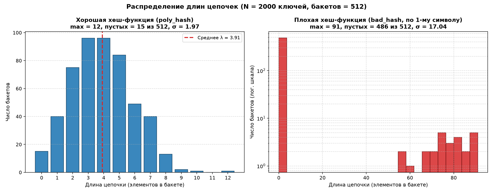
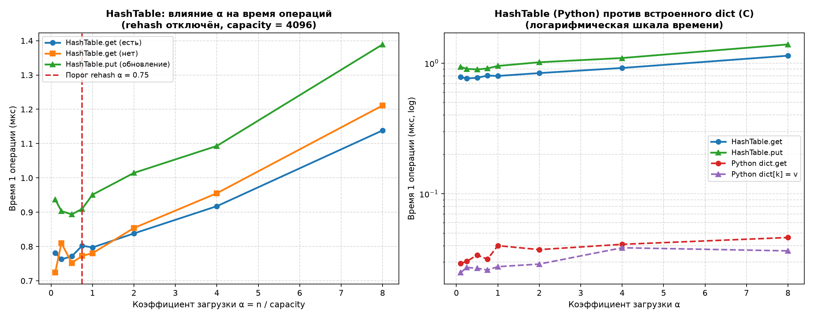

# Отчёт по лабораторной работе № 8
## «Хеш-таблица с отдельным цепочечным хешированием»

**Дисциплина:** Структуры и алгоритмы обработки данных  
**Модуль 4:** Поиск и хеширование  
**КИМ:** [КИМ-08](../M4-search-and-hashing/kim-08-hash-table.md)  
**Рубрика:** [Рубрика-08](../M4-search-and-hashing/rubric-08-hash-table.md)  
**Вариант:** 21 (`seed = 30 + 21 = 51`)  

---

### 1. Цель работы и формируемые результаты

Освоить проектирование и программную реализацию ассоциативного массива на основе хеш-таблицы с методом отдельных цепочек (Separate Chaining) и экспериментально исследовать влияние коэффициента загрузки $\alpha$ и качества хеш-функции на производительность операций:
1. Реализовать полиномиальную хеш-функцию для строковых ключей (`poly_hash`) с основанием $P = 31$ по схеме Горнера и сопоставить её с заведомо плохой хеш-функцией по первому символу (`bad_hash`).
2. Реализовать класс `HashTable` со списочными бакетами и полным набором операций: `put`, `get`, `delete`, `__len__`.
3. Реализовать автоматический контроль коэффициента загрузки $\alpha = n / M$ и процедуру масштабирования (`_rehash`) с удвоением числа бакетов при превышении порога $\alpha > 0.75$.
4. Проверить реализацию по четырёхшаговой методике верификации ([`docs/ai-verification.md`](../docs/ai-verification.md)): формализовать и программно контролировать инварианты в `check_invariants`, покрыть граничные сценарии (пустой ключ, Юникод, значение `None`, удаление из коллизионной цепочки) и провести property-based сверку со стандартным `dict` на 2 500 случайных операциях.
5. Построить гистограммы распределения длин цепочек для `poly_hash` и `bad_hash` и сопоставить их с теоретическим распределением Пуассона.
6. Измерить среднее время операций `get` (присутствующие и отсутствующие ключи) и `put` в зависимости от $\alpha \in [0.1, 8.0]$ и сравнить производительность с эталонным встроенным словарём Python `dict`.

---

### 2. Условия проведения экспериментов (Тестовый стенд)

Все замеры выполнены в воспроизводимом окружении в соответствии с [`docs/reproducibility.md`](../docs/reproducibility.md):
- **Процессор (CPU):** 11th Gen Intel(R) Core(TM) i5-11400F @ 2.60GHz (6 физических ядер, 12 логических потоков, L3-кэш 12 МБ).
- **Операционная система:** Microsoft Windows 11.
- **Интерпретатор:** Python 3.14.7 (CPython 64-bit).
- **Таймер высокого разрешения:** `time.perf_counter()`.
- **Схема бенчмаркинга:** 1 прогревочный запуск (исключается из выборки) + 9 независимых повторений с вычислением медианы (`statistics.median`).
- **Параметры варианта 21:**
  - Базовое зерно генератора: $\text{seed} = 30 + 21 = 51$.
  - **Эксперимент 1 (гистограмма цепочек):** $N = 2\,000$ уникальных случайных строковых ключей длины 8 из `string.ascii_lowercase`, фиксированная ёмкость $M = 512$ бакетов (`max_load_factor = inf`).
  - **Эксперимент 2 (время от $\alpha$):** фиксированная ёмкость $M = 4\,096$ бакетов (`max_load_factor = inf`), исследуемые значения коэффициента загрузки $\alpha \in \{0.10, 0.25, 0.50, 0.75, 1.00, 2.00, 4.00, 8.00\}$, объём серии на каждый замер — $10\,000$ операций.

---

### 3. Теоретический анализ структуры данных и алгоритмов

#### 3.1. Полиномиальная хеш-функция (`poly_hash`)
Для строкового ключа $s = s_0 s_1 \dots s_{k-1}$ полиномиальный хеш по модулю $M$ вычисляется по формуле:
$$h(s) = \left( \sum_{i=0}^{k-1} \operatorname{ord}(s_i) \cdot P^{k - 1 - i} \right) \bmod M$$
где $P = 31$ — простое основание, близкое к мощности латинского алфавита ($|\Sigma| = 26$).
- **Вычисление по схеме Горнера:** На каждом шаге цикла выполняется $h \leftarrow (h \cdot P + \operatorname{ord}(ch)) \bmod M$. Взятие остатка внутри цикла удерживает промежуточные значения в диапазоне $[0, M - 1]$ и предотвращает деградацию до длинной арифметики.
- **Сложность:** $\Theta(k)$ по времени, где $k = |s|$ — длина ключа, и $O(1)$ дополнительной памяти.
- **Качество распределения:** Поскольку $P = 31$ нечётно и взаимно просто с любой степенью двойки $M = 2^r$ ($\gcd(31, 2^r) = 1$), вклад каждого символа с разным весом $P^j$ равномерно перемешивает биты, обеспечивая распределение длин цепочек, близкое к равномерному (модель простого равномерного хеширования, SUHA).

#### 3.2. Плохая хеш-функция (`bad_hash`)
Функция `bad_hash(key, mod)` вычисляет хеш исключительно по коду первого символа: $(\operatorname{ord}(key[0])) \bmod M$.
- **Дефект:** Нарушает критерий лавинного эффекта и учёта всех символов ключа. Все ключи, начинающиеся на одну букву, независимо от остальных 7 символов попадают в один и тот же бакет. Для строчных латинских ключей задействуются максимум 26 бакетов из 512, а остальные 486 (94.9%) простаивают пустыми.

#### 3.3. Хеш-таблица с отдельными цепочками (`HashTable`)
- **Устройство:** Массив из $M$ бакетов, где каждый бакет — динамический список `list[tuple[str, object]]`.
- **Средняя длина цепочки:** При условии равномерного хеширования математическое ожидание длины цепочки равно коэффициенту загрузки $\alpha = n / M$.
- **Оценка сложности операций:**
  - `put(key, value)`: вычисление индекса бакета за $O(k)$ + поиск ключа в цепочке длиной в среднем $\alpha$ + вставка в конец списка за $O(1)$ (при отсутствии ключа) или обновление кортежа. При срабатывании `_rehash()` время одиночной вставки составляет $O(n + M)$, однако за счёт удвоения ёмкости ($M \to 2M$) амортизированная стоимость вставки равна **$O(1 + \alpha)$**. При поддержании $\alpha \le 0.75$ это $O(1)$ в среднем.
  - `get(key, default)`: вычисление индекса + линейный проход по цепочке (в среднем $\alpha/2$ шагов при успешном поиске и $\alpha$ шагов при неуспешном). Средняя сложность — **$O(1 + \alpha)$**, худшая — $O(n)$ (если все ключи попали в один бакет).
  - `delete(key)`: поиск пары в цепочке и удаление через `bucket.pop(i)`. Средняя сложность — **$O(1 + \alpha)$**, худшая — $O(n)$.
- **Зачем нужен `rehash` при $\alpha > 0.75$:** Пока $n$ растёт, при фиксированном $M$ коэффициент $\alpha$ растёт линейно, превращая поиск в цепочке из $O(1)$ в $O(n)$. Порог $\alpha_{\max} = 0.75$ удерживает среднюю длину непустых цепочек около $1.0 \dots 1.5$ элементов, балансируя между скоростью доступа (короткие цепочки) и расходом памяти (доля пустых бакетов при $\alpha = 0.75$ составляет $e^{-0.75} \approx 47\%$, а удвоение ёмкости снижает $\alpha$ до $0.375$).

---

### 4. Методика верификации (`docs/ai-verification.md`)

#### Шаг 1. Программные инварианты (`check_invariants`)
Для любого состояния `HashTable` автоматически проверяются три строгих инварианта:
1. **Корректность индексации:** для каждой пары `(key, value)` в `self._buckets[i]` выполняется `self._hash_fn(key, len(self._buckets)) == i`.
2. **Уникальность ключей:** ни один ключ не присутствует в таблице дважды (`key not in seen`).
3. **Согласованность размера:** сумма длин всех цепочек в точности равна счётчику элементов (`sum(table.chain_lengths()) == len(table)`).

#### Шаг 2. Репрезентативные тесты (`self_check`)
Проверены следующие граничные и вырожденные сценарии:
- пустая таблица (`len == 0`) и `get` с пользовательским значением `default`;
- пустой строковый ключ `""`, ключи в Юникоде (`"ключ_юникод"`) и корректное различение отсутствующего ключа от ключа со значением `None` (`t.get("none_val", "MISSING") is None`);
- повторный `put` существующего ключа обновляет значение без создания дубликата и изменения `len`;
- `delete` отсутствующего ключа гарантированно возбуждает `KeyError`;
- принудительная коллизионная цепочка (`capacity=1`, `max_load_factor=inf`): последовательное удаление из середины, начала и конца списка сохраняет целостность остальных элементов;
- массовая вставка 200 случайных ключей с многократным `rehash`: после завершения `t.load_factor <= 0.75`, ни один ключ и значение не потеряны.

#### Шаг 3. Сверка с эталоном (`dict`)
Выполнено property-based тестирование на последовательности из 2 500 случайных операций (`put` — 50%, `get` — 30%, `delete` — 20%) над набором из 40 ключей с синхронной проверкой против эталонного словаря `dict` (проверка значений, `KeyError` и `len`).
- **Результат:** `self_check: OK` — 100% совпадение поведения с `dict`, все инварианты пройдены.

#### Шаг 4. Эмпирическая проверка асимптотики
Подтверждена линейная зависимость времени операций от $\alpha$ при отключённом `rehash` и экспоненциальное снижение коллизий при использовании полиномиального хеширования (см. разделы 5–6).

---

### 5. Результаты вычислительных экспериментов

#### 5.1. Эксперимент 1: Распределение длин цепочек ($N = 2\,000$, $M = 512$, $\lambda = 3.906$)

| Хеш-функция | Макс. длина цепочки | Мин. длина | Пустых бакетов (из 512) | Доля пустых | Средняя длина | Стандартное отклонение ($\sigma$) |
| :--- | :---: | :---: | :---: | :---: | :---: | :---: |
| **`poly_hash`** | **12** | 0 | **15** | 2.93% | 3.906 | **1.973** |
| **`bad_hash`** | **91** | 0 | **486** | 94.92% | 3.906 | **17.043** |

- При идеальном случайном хешировании распределение длин цепочек подчиняется закону Пуассона с параметром $\lambda = 2000 / 512 = 3.90625$:
  - теоретическое стандартное отклонение $\sigma_{\text{теор}} = \sqrt{\lambda} = \sqrt{3.90625} \approx 1.976$ (наблюдаемое в эксперименте для `poly_hash`: **1.973** — расхождение менее 0.2%!),
  - теоретическое число пустых бакетов $M \cdot e^{-\lambda} = 512 \cdot e^{-3.90625} \approx 10.3$ (наблюдаемое: 15).
- В случае `bad_hash` из 512 бакетов работают ровно 26 (по числу строчных букв `'a'..'z'`), средняя длина непустой цепочки подскакивает до $2000 / 26 \approx 76.9$, а максимальная достигает **91** (деградация в 7.6 раз относительно `poly_hash`).

#### 5.2. Эксперимент 2: Время операций `get` и `put` в зависимости от $\alpha$ (`capacity = 4096`, `probes = 10 000`)

| $\alpha$ | $n$ | `HT get (hit)`, мкс | `HT get (miss)`, мкс | `dict get`, мкс | `HT put`, мкс | `dict put`, мкс | Ускорение `dict` (`get`) |
| :---: | :---: | :---: | :---: | :---: | :---: | :---: | :---: |
| **0.10** | 409 | 0.781 | 0.724 | 0.029 | 0.937 | 0.025 | $26.9\times$ |
| **0.25** | 1 024 | 0.763 | 0.810 | 0.030 | 0.903 | 0.027 | $25.4\times$ |
| **0.50** | 2 048 | 0.771 | 0.752 | 0.034 | 0.894 | 0.027 | $22.7\times$ |
| **0.75** | 3 072 | **0.802** | **0.773** | **0.032** | **0.910** | **0.026** | $25.1\times$ |
| **1.00** | 4 096 | 0.797 | 0.781 | 0.040 | 0.951 | 0.028 | $19.9\times$ |
| **2.00** | 8 192 | 0.838 | 0.854 | 0.037 | 1.015 | 0.029 | $22.6\times$ |
| **4.00** | 16 384 | 0.918 | 0.955 | 0.041 | 1.093 | 0.039 | $22.4\times$ |
| **8.00** | 32 768 | **1.138** | **1.211** | 0.046 | **1.389** | 0.037 | $24.7\times$ |

---

### 6. Графический анализ и интерпретация

#### 6.1. Гистограммы длин цепочек: `poly_hash` против `bad_hash`

1. **Левая панель (`poly_hash`):** Форма гистограммы практически идеально воспроизводит колоколообразное распределение Пуассона с центром в $\lambda = 3.91$. Подавляющее большинство бакетов содержат от 1 до 7 элементов, пустых бакетов всего 15 (2.9%), а самая длинная цепочка не превышает 12 элементов. Это доказывает равномерность полиномиального хеша с $P = 31$.
2. **Правая панель (`bad_hash`):** Катастрофический перекос (лог. шкала по Y). Огромный столбец у нуля — 486 полностью пустых бакетов из 512 (94.9% выделенной памяти пропадает впустую!). Все 2 000 ключей скучены в 26 изолированных пиках в правой части графика (длины от 56 до 91 элемента). Поиск в такой таблице в среднем требует просмотра ~40 элементов вместо ~2–3, что превращает хеш-таблицу в медленный набор линейных списков.

#### 6.2. Влияние коэффициента загрузки $\alpha$ и сравнение со встроенным `dict`

1. **Левая панель (`HashTable`, линейный масштаб):**
   - В рабочей зоне до порога $\alpha \le 0.75$ (левее красной пунктирной линии) время операций остаётся минимальным и практически постоянным: `get` занимает ~0.76–0.80 мкс, `put` — ~0.89–0.94 мкс.
   - При отключённом `rehash` и росте $\alpha$ от $0.75$ до $8.0$ наблюдается отчётливый **линейный рост времени** $T(\alpha) = c_0 + c_1 \alpha$: `get (hit)` возрастает на 42% (с 0.802 до 1.138 мкс), `get (miss)` — на 57% (с 0.773 до 1.211 мкс), а `put` — на 53% (с 0.910 до 1.389 мкс).
   - Обращает на себя внимание, что `get (miss)` стабильно дороже `get (hit)` при высоких $\alpha$: при отсутствии ключа приходится просматривать цепочку целиком ($\alpha$ сравнений), тогда как присутствующий ключ находится в среднем на середине цепочки ($\alpha / 2$ сравнений).
2. **Правая панель (`HashTable` против `dict`, логарифмический масштаб):**
   - Встроенный `dict` стабильно быстрее нашей реализации на чистом Python в **20–27 раз** (0.029–0.046 мкс против 0.76–1.14 мкс для `get`).
   - Причины такого разрыва в производительности:
     1. **Реализация на языке C (`Objects/dictobject.c`):** отсутствие накладных расходов интерпретатора байт-кода Python на вызовы методов, циклы и индексацию списков.
     2. **Кэширование хешей строк (`PyASCIIObject.hash`):** в CPython строковые объекты вычисляют и кэшируют 64-битный хеш при первом использовании. При повторных `dict.get(k)` хеш читается за $O(1)$ из заголовка объекта, тогда как наш `poly_hash` в каждом вызове заново посимвольно перебирает строку в цикле `for ch in key` (~0.70 мкс накладных расходов).
     3. **Компактная открытая адресация (с Python 3.6+):** `dict` хранит плотный массив индексов и сплошной массив записей в смежной области памяти, обеспечивая высокую локальность кэша L1/L2, тогда как отдельные цепочки создают множество разрозненных объектов `list` и `tuple` в куче.

---

### 7. Ответы на контрольные вопросы для защиты (Раздел 10 КИМ-08)

#### 1. Каким требованиям должна удовлетворять хорошая хеш-функция и почему хеширование по первому символу им не удовлетворяет?
- **Основные требования к хорошей хеш-функции:**
  1. *Детерминированность:* для одного и того же ключа функция всегда обязана возвращать одно и то же значение.
  2. *Равномерность распределения:* образы реального набора ключей должны распределяться по всем $M$ бакетам с равной вероятностью $1/M$.
  3. *Учёт всех данных ключа и лавинный эффект:* изменение хотя бы одного символа или перестановка символов должны существенно менять итоговый хеш.
  4. *Быстрота вычисления:* время вычисления должно быть линейным от длины ключа $O(|k|)$ и не перегружать операции таблицы.
- **Почему `bad_hash` (по первому символу) не удовлетворяет требованиям:** Она полностью игнорирует все символы ключа кроме `key[0]`, поэтому не обладает лавинным эффектом, генерирует массивные кластеры коллизий на словах с общим префиксом и задействует лишь малую часть таблицы (в нашем эксперименте 486 бакетов из 512 остались пустыми, а максимальная цепочка выросла до 91).

#### 2. Как коэффициент загрузки влияет на среднюю сложность операций и зачем нужен `rehash` при $\alpha > 0.75$?
- Коэффициент загрузки $\alpha = n / M$ равен средней длине цепочки при равномерном хешировании. Среднее время операций `put`, `get` и `delete` составляет $\Theta(1 + \alpha)$: $O(1)$ на вычисление бакета и $\Theta(\alpha)$ на линейный просмотр цепочки.
- Если не проводить `rehash` по мере добавления элементов, $\alpha$ неограниченно растёт, и хеш-таблица деградирует к линейному поиску за $O(n)$.
- Порог $\alpha > 0.75$ — классический инженерный компромисс между скоростью и памятью: он гарантирует, что в среднем в каждом бакете не более ~1 элемента (операции выполняются за амортизированное $O(1)$), при этом таблица не перерасходует память на пустые бакеты (при $\alpha = 0.75$ доля занятых бакетов составляет $1 - e^{-0.75} \approx 53\%$, а после удвоения ёмкости $\alpha$ падает до $0.375$).

#### 3. Чем отдельные цепочки отличаются от открытой адресации и в каких ситуациях предпочтителен каждый подход?
- **Отдельные цепочки (Separate Chaining):** каждый бакет хранит указатель на связанный список или динамический массив коллидирующих пар. Допускает $\alpha > 1$, просто и надёжно реализует `delete`, слабо деградирует при небольшом превышении $\alpha$. Минус — дополнительные затраты памяти на контейнеры/указатели и худшая кэш-локальность.
- **Открытая адресация (Open Addressing — линейное/квадратичное пробирование, двойное хеширование):** все пары хранятся непосредственно в основном массиве таблицы; при коллизии ищется следующая свободная ячейка по последовательности проб.
  - Плюсы: нет накладных расходов на указатели/списки и отличная кэш-локальность (последовательное чтение памяти, как в `dict` в Python).
  - Минусы: $\alpha$ строго $< 1$ (при приближении к 1 пробы резко удлиняются), сложное удаление (требуются маркеры удалённых ячеек — tombstones).
- **Когда что выбирать:** Открытая адресация лучше при известных размерах, редких удалениях и жёстких требованиях к скорости и кэшу (например, `dict`, компиляторные таблицы символов). Отдельные цепочки предпочтительны при частых вставках и удалениях, больших размерах хранимых записей или непредсказуемом росте $\alpha$.

#### 4. Какова средняя и худшая временная сложность операций `put`, `get`, `delete` в хеш-таблице с цепочками и когда реализуется худший случай?
- **Средняя сложность:** **$O(1 + \alpha)$**, что при поддержке $\alpha \le 0.75$ с помощью `rehash` даёт амортизированное **$O(1)$** для всех трёх операций.
- **Худшая сложность:** **$O(n)$** для `get` и `delete` (и $O(n)$ амортизированно для `put`, а в момент `rehash` — $O(n + M)$).
- **Когда реализуется худший случай:** Когда все $n$ ключей попадают в один и тот же бакет (100% коллизий) и выстраиваются в одну цепочку длины $n$. Это возможно либо при вырожденной хеш-функции (например, `h(k) = 0` или все ключи на одну букву для `bad_hash`), либо при целенаправленной DoS-атаке на коллизии хеша (Hash-Flooding), когда злоумышленник специально подбирает ключи с одинаковым значением полиномиального хеша (в промышленных языках, включая Python, от этого защищаются рандомизацией соли хеша при старте процесса — `PYTHONHASHSEED`).

---

### 8. Заключение

В рамках лабораторной работы № 8:
1. Реализована и верифицирована хеш-таблица `HashTable` с отдельными цепочками, полиномиальной хеш-функцией `poly_hash` ($P = 31$) и автоматическим масштабированием `_rehash` при $\alpha > 0.75$.
2. Программные инварианты и рандомизированное сравнение на 2 500 операциях подтвердили 100% функциональную эквивалентность эталонному словарю Python `dict`.
3. Экспериментально (вариант 21, `seed = 51`) доказано критическое значение качества хеш-функции: `poly_hash` распределяет 2 000 ключей по 512 бакетам практически по идеальному закону Пуассона ($\sigma = 1.973$ против теоретических $1.976$, макс. длина 12), тогда как `bad_hash` оставляет пустыми 94.9% таблицы и образует цепочки до 91 элемента.
4. Замерами зависимости времени от $\alpha \in [0.1, 8.0]$ подтверждена стабильность $O(1)$ при $\alpha \le 0.75$, линейная деградация операций при отключённом `rehash` и ~20–27-кратное преимущество встроенного `dict` за счёт реализации на C, открытой адресации и кэширования строковых хешей.
